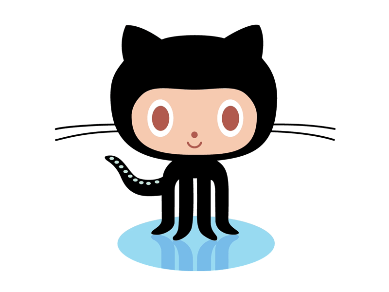
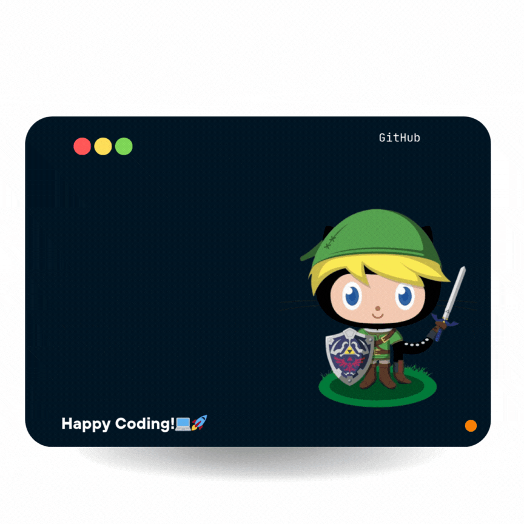
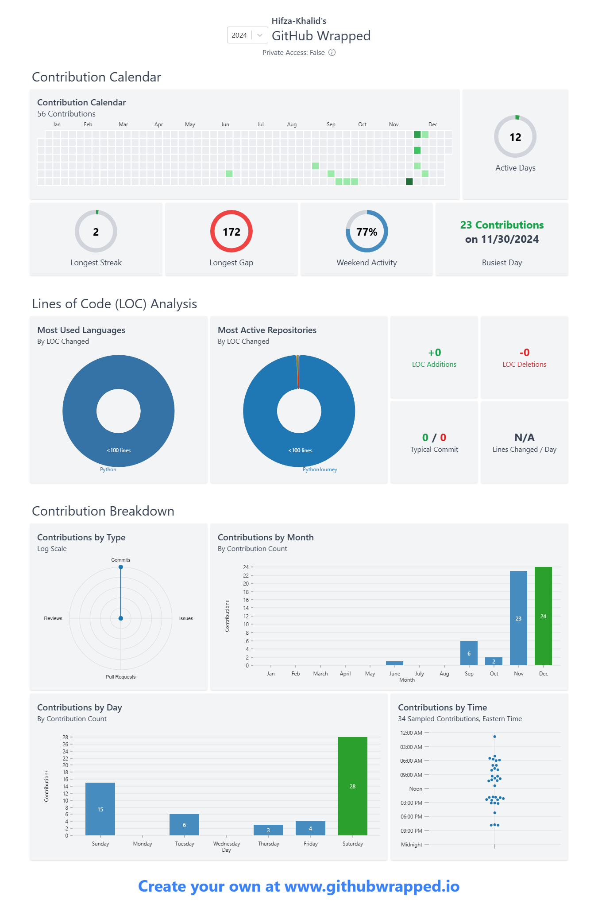

  

<h1 align="center">Hi ,I'm Hifza Khalid</h1>

  

---
<h3 align="center">🚀 About Me</h3>

  Software Engineer passionate about building full-stack applications and exploring Artificial Intelligence. 
  I enjoy turning ideas into practical solutions, learning emerging technologies, and solving real-world problems through code.

---
<h3 align="center"> 🔥 Highlights </h3>

  
  <ul>
<li><b>Currently Building:</b> Agentic AI Applications & Intelligent AI Agents </li>
<li><b>Exploring:</b> LLMs, RAG, AI Agents & MLOps</li>
<li><b>Open to Collaborate:</b> Full Stack & AI Projects</li>
<li><b>Ask Me About:</b> Software Engineering, Web Development & AI/ML</li>
<li><b>Reach Me At:</b> <a href="mailto:hifzaofpk@gmail.com">hifzaofpk@gmail.com</a></li>
  </ul>

---

<table>
<tr>
<td width="65%" valign="middle" style="border: none;">

<h3>✍️ Tech Insights with Hifza</h3>

Welcome to my tech blog! Here, you'll find insightful articles on technology, programming, AI, and more.

- Coming soon... Stay tuned for insightful tech blogs!

### 📜 Daily Quote

<!-- QUOTE-START -->

Happiness is the meaning and the purpose of life, the whole aim and end of human existence. - Aristotle

<!-- QUOTE-END -->

</td>

<td width="35%" align="center" valign="middle" style="border: none;">

 

<b>🐟 Hifza's Fish</b>

 

Redrawn every night from my GitHub activity

</td>
</tr>
</table>

---

<h3 align="center"> 🔧 Tools I Use </h3>

  

<h2>Skills & Technologies</h2>

<table width="100%">
  <tr>
    <td width="25%"><b>Programming Languages</b></td>
    <td>
      
    </td>
  </tr>
  <tr>
    <td><b>Frontend Development</b></td>
    <td>
      
    </td>
  </tr>
  <tr>
    <td><b>Backend Development</b></td>
    <td>
      
    </td>
  </tr>
  <tr>
    <td><b>AI / Machine Learning</b></td>
    <td>
      
    </td>
  </tr>
  <tr>
    <td><b>Databases</b></td>
    <td>
      
    </td>
  </tr>
  <tr>
    <td><b>MLOps & DevOps</b></td>
    <td>
      
    </td>
  </tr>
  <tr>
    <td><b>Data Science & Workflow</b></td>
    <td>
      
    </td>
  </tr>
  <tr>
    <td><b>Tools & Platforms</b></td>
    <td>
      
    </td>
  </tr>
</table>

<h2 align="center"> 🎨 Mastering the Art of Documentation </h2>

  
  
  
Bridging the gap between <strong>ideas and execution</strong> with well-structured, insightful, and developer-friendly documentation.

  <table align="center">
    <tr>
      <th>📌 Skill</th>
      <th>⭐ Rating</th>
    </tr>
    <tr>
      <td><strong>Software Requirement Specifications (SRS)</strong></td>
      <td>⭐⭐⭐⭐⭐</td>
    </tr>
    <tr>
      <td><strong>Software Architecture & Design Docs</strong></td>
      <td>⭐⭐⭐⭐☆</td>
    </tr>
    <tr>
      <td><strong>Technical Writing & Knowledge Base</strong></td>
      <td>⭐⭐⭐⭐☆</td>
    </tr>
    <tr>
      <td><strong>UML & System Diagrams</strong></td>
      <td>⭐⭐⭐⭐☆</td>
    </tr>
  </table>

  <h3 > 🔄 Currently Learning </h3>

  <table align="center">
    <tr>
      <th>🚀 Skill</th>
      <th>⭐ Progress</th>
    </tr>
    <tr>
      <td><strong>API Documentation & OpenAPI Standards</strong></td>
      <td>⭐⭐⭐☆☆</td>
    </tr>
    <tr>
      <td><strong>Agile Documentation & Confluence</strong></td>
      <td>⭐⭐☆☆☆</td>
    </tr>
  </table>

## 📊 GitHub Stats

  
  

  

  <!-- GitHub Streak (Light theme) -->
  

  
  <!-- GitHub Streak -->
  
  

  

---

## 📌 Developer Productivity Snippets

  🚀 Explore some of my handy productivity snippets to boost your workflow!  

  

## 🌟 My Favorite VS Code Extensions  
I’ve curated a list of my go-to VS Code extensions to boost productivity and streamline development. 

---
## 🏅 My Badges

  

## 🚀 GitHub Wrapped 2024 

  
📌 Click to view GitHub Wrapped 2024 📊

  

### 🌐 Let's Connect!

   
  
  
  
  
  

  
### Thanks for visiting!👋

_Feel free to star ⭐ some repositories if you find them interesting!_

  

